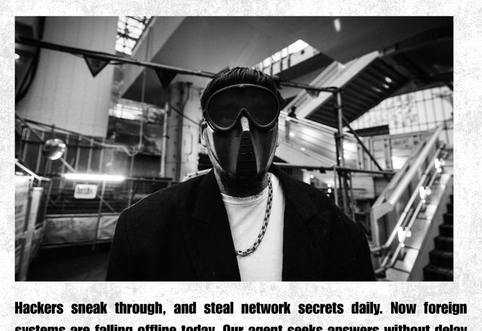
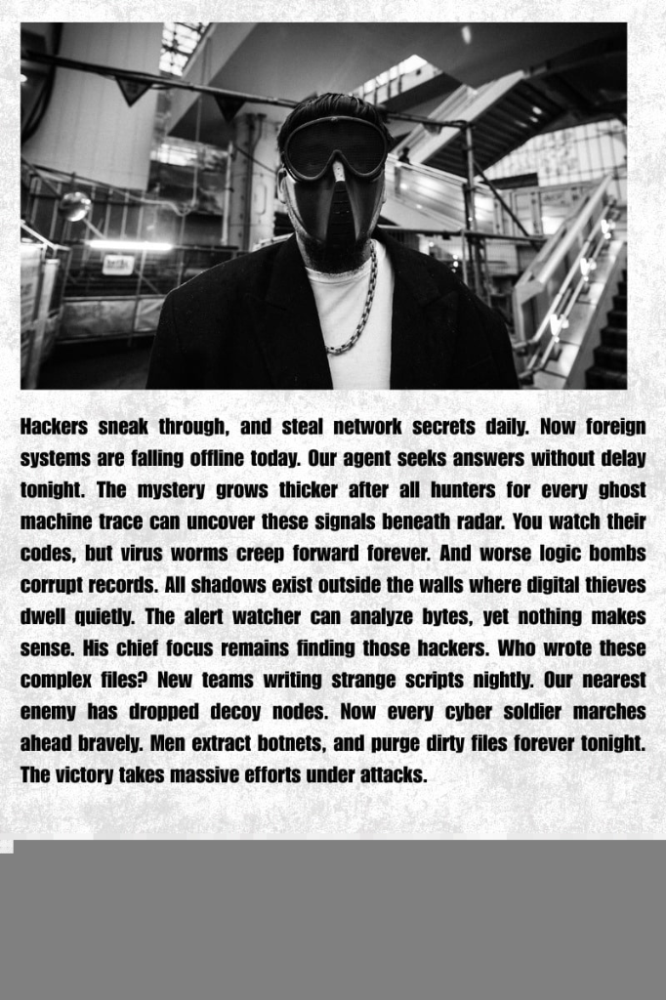
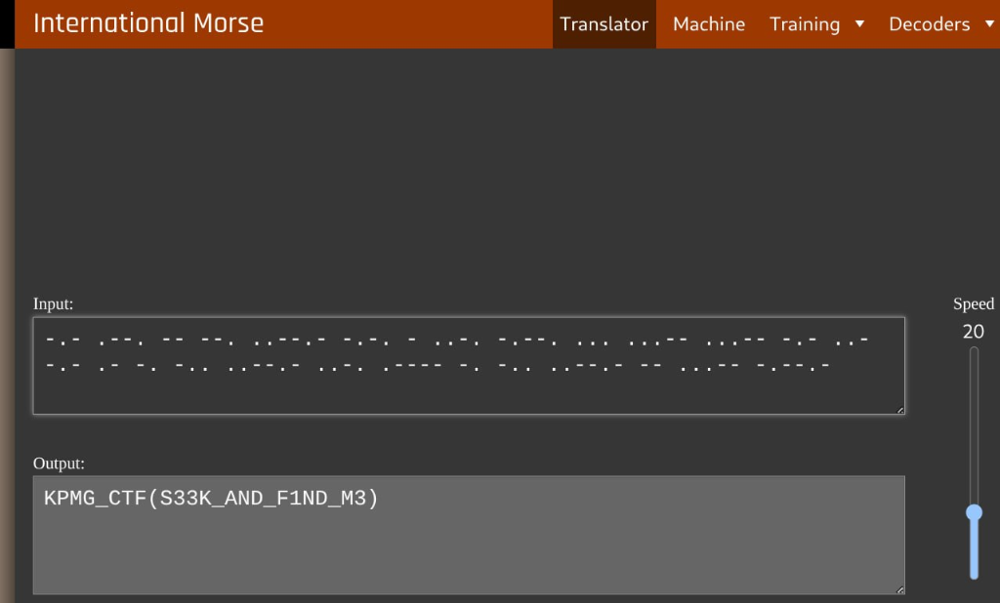

# Challenge Name: Corrupted Vision
**Category:** Cryptography / Steganography
**Points:** 30
**Difficulty:** Hard

### Description
An image file appeared corrupted and would not display normally. The objective was to repair the file sufficiently to inspect its contents and recover a hidden flag.

### Approach
1. Rather than treating the broken image as a simple viewing issue, inspected the underlying file structure directly — the JPEG header and metadata looked deliberately altered rather than genuinely damaged.
2. Found two specific issues: a disguised/corrupted JPEG header, and an image height field that had been shortened/falsified — classic "repair the container format" CTF steganography pattern.
3. Restored the correct JPEG header bytes and corrected the height field so the file could be parsed and rendered properly by standard image tools.

### Solution
1. Once repaired, the image revealed a concealed message encoded via **word length as a Morse-code substitute**:
   - A five-character word represented a dot (`.`)
   - A seven-character word represented a dash (`-`)
   - A three-character word acted as a separator between Morse characters
2. Walked through the hidden text, mapping each word to its Morse symbol based on length, then translated the resulting Morse sequence into the final plaintext flag.

### Flag
`[REDACTED]`

### Proof

### What I Learned
- A "corrupted" image in a CTF is rarely actually corrupted — it's usually a deliberately altered file header/metadata field (like image height) hiding additional data below what a naive renderer would show.
- Always inspect raw file structure (hex view, magic bytes, dimension fields) before assuming a broken file is unrecoverable; JPEG dimensions can be desynced from the actual pixel data present in the file.
- Steganographic encodings don't have to be pixel-based (LSB, etc.) — this one encoded Morse code purely through **word length** in an otherwise innocuous-looking text, which is easy to miss if you're only looking for visual/binary steganography techniques.
