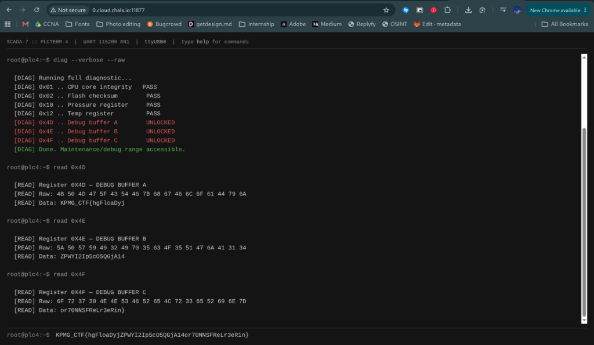

# Challenge Name: Baud Intentions
**Category:** OT/IoT
**Points:** 10
**Difficulty:** Easy

### Description
A legacy industrial interface is still online, and it reveals more than it should. Explore the system, understand how it works, and see what you can recover.

`http://0.cloud.chals.io:32225`

### Approach
1. The challenge listed the URL as `https://`, but connecting via TLS failed (`SSL routines::wrong version number`). `nmap -sV` confirmed the service was actually plain HTTP running `Werkzeug` (Python Flask dev server) — the `https://` in the description was just a label, not the real protocol.
2. Loaded the page over plain `http://` and found a simulated "PLCTERM-4 UART Console" web terminal, backed by a `/cmd` POST endpoint.
3. Used the in-page `help` command to enumerate available commands: `sysinfo`, `status`, `diag [flags]`, `mem`, `auth <key>`, `read <register>`, `clear`, `help`.
4. `sysinfo` revealed a device serial number (`SN-7743-ALPHA`); `mem` revealed the documented register address map, including a locked `0x4D-0x4F` "maintenance/debug" range.

### Solution
1. Swept every documented register address with `read <reg>` via curl, looking for anything beyond the generic "no data or reserved" response.
2. Register `0x48` leaked a credential template: `LEGACY_SERVICE_KEY: MAINT-<UNIT>`.
3. Filled in `<UNIT>` using the serial number from `sysinfo` — tried `MAINT-7743` (just the numeric portion of `SN-7743-ALPHA`) and it was accepted:
   ```bash
   curl -s -c cookies.txt -b cookies.txt -X POST http://0.cloud.chals.io:32225/cmd \
     -H "Content-Type: application/json" \
     -d '{"command":"auth MAINT-7743"}'
   ```
4. Kept the session cookie (`-c cookies.txt -b cookies.txt`) on all subsequent requests to stay authenticated.
5. Ran `diag --verbose --raw` to confirm the maintenance registers (`0x4D`-`0x4F`) were now unlocked.
6. Read each of the three now-unlocked debug buffer registers — each held a hex-encoded ASCII chunk of the flag:
   ```bash
   curl -s -c cookies.txt -b cookies.txt -X POST http://0.cloud.chals.io:32225/cmd \
     -H "Content-Type: application/json" -d '{"command":"read 0x4D"}'
   # ...repeat for 0x4E, 0x4F
   ```
7. Concatenated the three decoded "Data:" strings in order to assemble the complete flag.

### Flag
`[REDACTED]`

### Proof


### What I Learned
- Always fully enumerate a documented "memory map" or register range in these embedded/OT-simulation challenges — leaked credentials or hints are often sitting in plain sight in an unlocked register, disguised among mundane telemetry values.
- A `diag --help`-style command, even when unauthenticated, can leak flags/arguments (`--verbose`, `--raw`) needed later once authenticated — always probe help/usage text even on locked functionality.
- Session state (auth) in simple Flask apps is often cookie-based; forgetting `-c`/`-b` on curl calls silently starts a brand-new unauthenticated session each time, which can look like "nothing is unlocking" when really the auth never persisted.
- Don't take a challenge's stated protocol (`https://`) at face value — verify with `nmap -sV` or a direct connection test before assuming TLS is in play.
