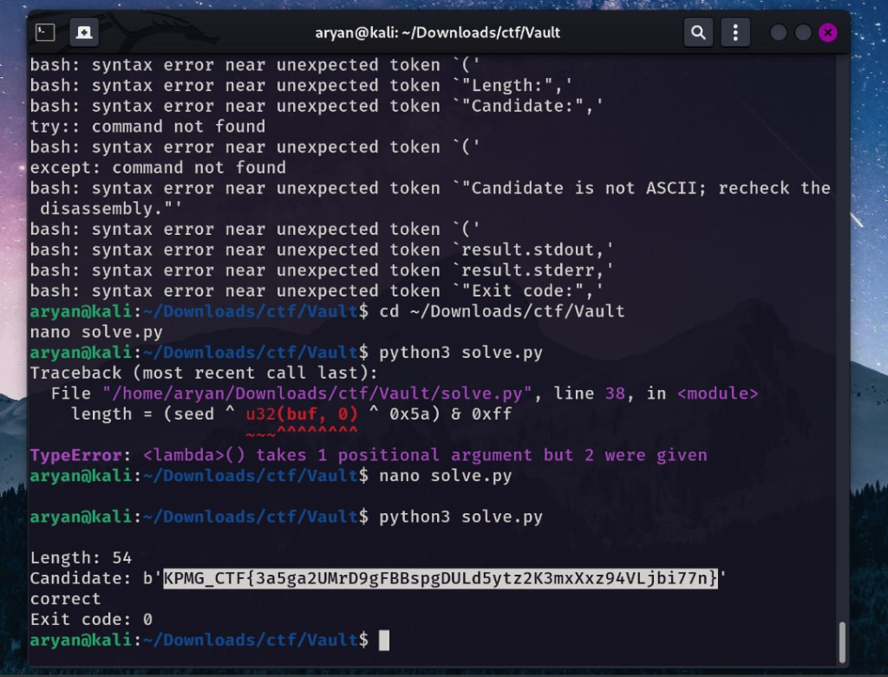

# Secure Vault
**Category:** Reverse Engineering · **Points:** 20 · **Difficulty:** Medium

### Description
A compiled binary ("Secure Vault") that validates a flag internally. The objective was to reverse engineer the validation logic and reconstruct the correct flag.

### Solution
1. Analyzed the binary using `strings`, `nm`, and `objdump` to understand the validation flow.
2. Identified the flag-checking logic — a seed-based XOR transformation that verifies each byte of the input against expected values.
3. Wrote a Python `solve.py` script to reverse the transformation:
   - Extracted the seed values and expected output from the binary
   - Reversed the XOR + mask operations to recover each flag byte
4. Ran the solver — after fixing a lambda argument bug, it successfully reconstructed the 54-byte flag and verified it as correct.

```bash
aryan@kali:~/Downloads/ctf/Vault$ python3 solve.py
Length: 54
Candidate: b'KPMG_CTF{...}'
correct
Exit code: 0
```

### Flag
`[REDACTED]`

### Proof


### What I Learned
- Static analysis (`strings`, `nm`, `objdump`) on unstripped binaries can quickly reveal validation functions and expected values without needing a debugger.
- XOR-based flag checks are common in CTF reversing — once you identify the transformation (seed, XOR key, mask), writing a solver to invert it is straightforward.
- Iterating on solve scripts is normal — the first attempt had a type error that was fixed by adjusting the lambda, then it worked.
