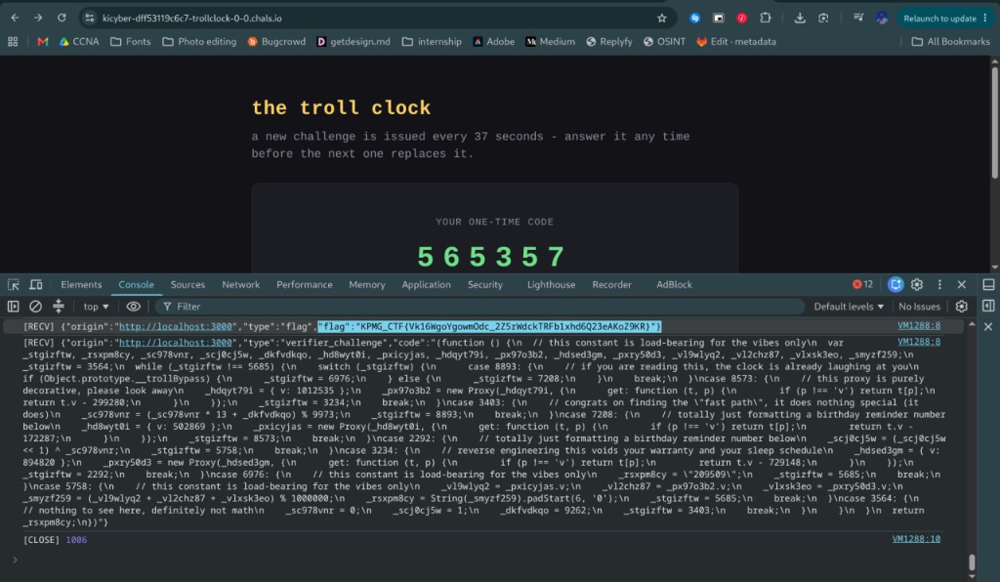
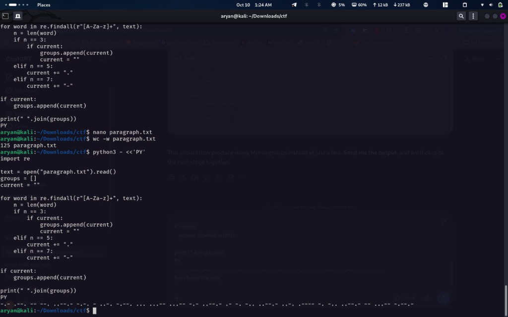

# Challenge Name: TrollClock
**Category:** Web
**Points:** 10
**Difficulty:** Easy

### Description
TrollClock presented a client-side OTP verification flow backed by a WebSocket connection. The objective was to bypass the apparent OTP protection to reach the flag.

### Approach
1. Inspected the client-side JavaScript and found the displayed OTP was generated with `Math.random()` and refreshed every ten seconds — a strong signal the OTP was purely cosmetic rather than a real server-side control.
2. Mapped out the application's intended flow:
   ```
   POST /verify-otp  →  POST /dashboard  →  WebSocket /ws
   ```
3. Instead of assuming the browser's normal navigation order was mandatory, tested each endpoint independently and out of order.

### Solution
1. Sent a direct request to `POST /dashboard` (skipping `/verify-otp` entirely) and got back:
   ```json
   {"ok":true}
   ```
   confirming the dashboard endpoint enforced no server-side authorization tied to OTP completion.
2. Connected directly to the `/ws` WebSocket endpoint and found it accepted the connection without requiring the OTP flow to have been completed first.
3. Checked `/robots.txt`, which surfaced an additional useful path for further investigation.
4. The WebSocket exchange revealed a clock-based verification mechanism. Analyzed the obfuscated client-side verifier logic and traced through how its expected value was computed.
5. Computed the correct verification value (`600399`) by replicating the verifier's logic.
6. Submitted that value via the WebSocket's `submit_window` message type, which returned the flag.

### Flag
`[REDACTED]`

### Proof




### What I Learned
- Client-side OTP generation (`Math.random()` in the browser) provides zero real security — anything computed and displayed client-side can be read, predicted, or ignored entirely by an attacker.
- A multi-step workflow (OTP → dashboard → WebSocket) must enforce authorization at every step **server-side**; if the dashboard or WebSocket endpoint doesn't independently verify that OTP was actually completed, the "flow" is purely cosmetic and every endpoint can be hit directly and out of order.
- WebSocket endpoints are a separate attack surface from standard HTTP routes and need their own explicit authentication/authorization checks — a common oversight when developers assume "you can only reach `/ws` after logging in through the UI."
- Obfuscated client-side verification logic can still be reverse engineered by tracing execution; obfuscation slows down analysis but isn't a substitute for actual security.
- `robots.txt` remains a useful, low-effort recon step even on modern SPA-style apps.
